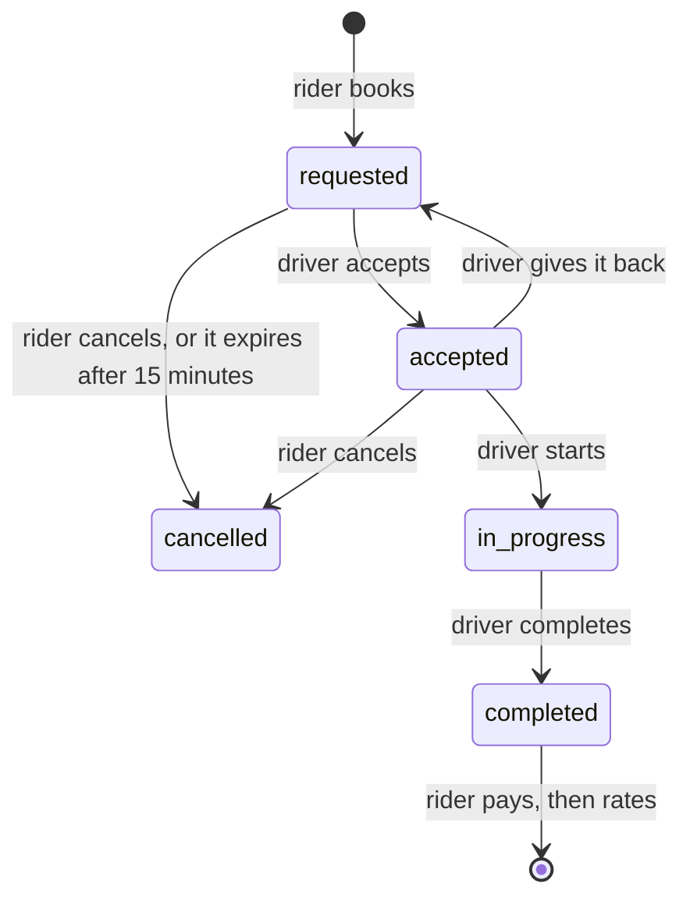
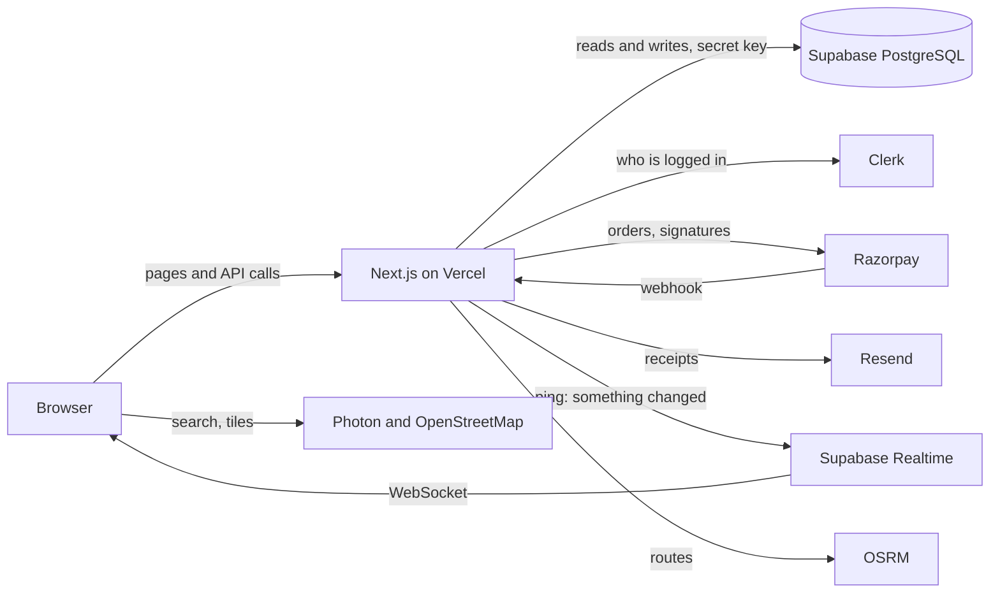
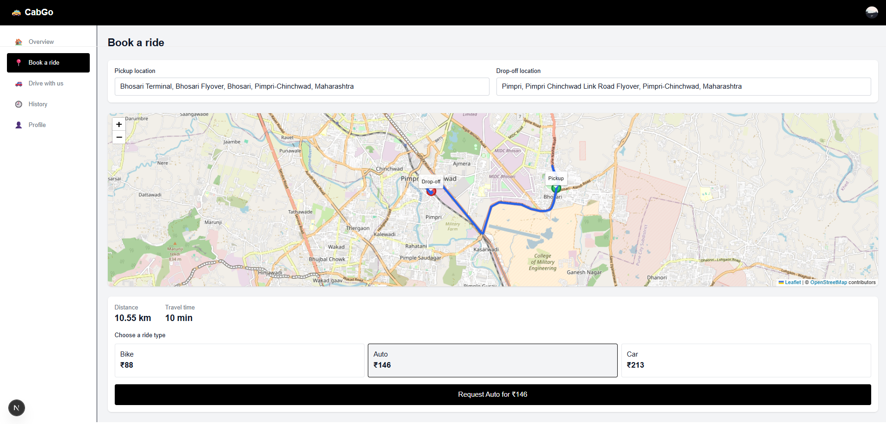
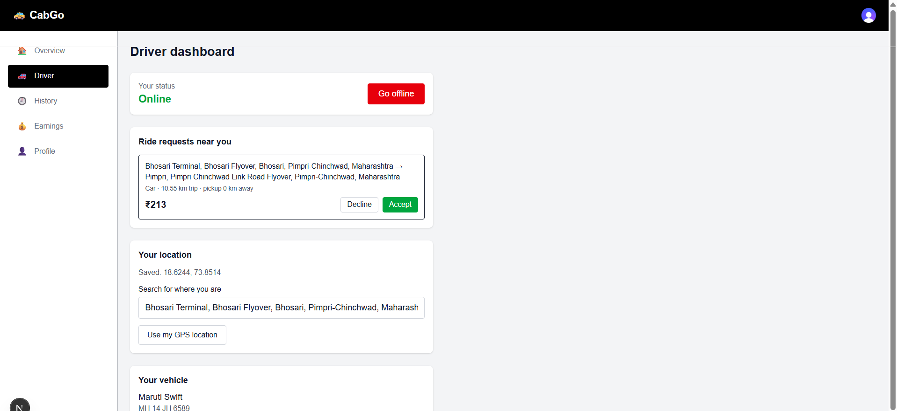
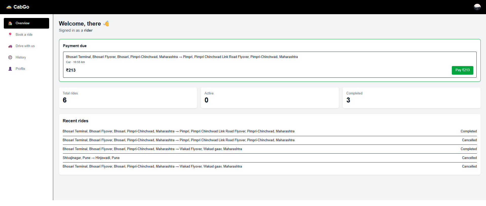
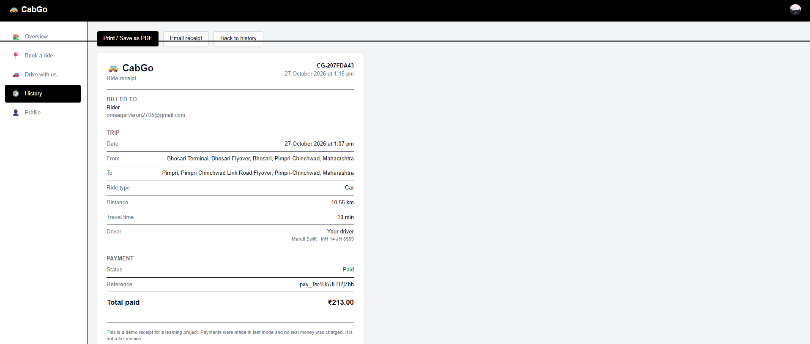
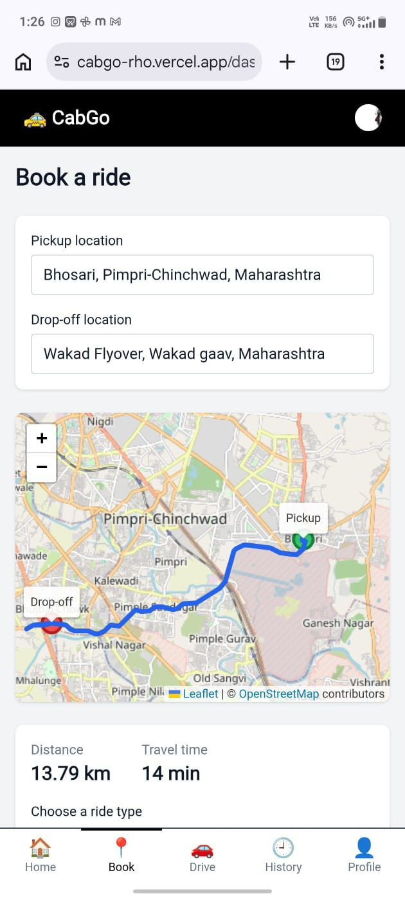

# 🚕 CabGo — a ride-hailing app

A full-stack ride-hailing app built in two weeks as a learning project. Riders book rides,
drivers accept and complete them, riders pay and get an emailed receipt, and both sides
see live updates.

> This is a portfolio and learning project. Payments run in **test mode** (no real money
> moves), and it isn't meant to be used as a real service.

**Live demo:** https://cabgo-rho.vercel.app/ · **Demo video:** ---------

**Try it:**

 sign up with any email or Google. Payments run in test mode, so use the test card `4386 2894 0766 0153` with any future expiry date, any 3-digit CVV, and any 4 to 10 digit code on the bank page. To see both sides of a ride, open the site in two browsers, and in one of them choose **Drive with us** to register as a driver. The site uses development login keys, so you will see a "Development mode" notice, and receipt emails are only delivered to the project owner.

## Features

**Riders**
- Sign up and log in with email or Google, and edit a profile with a picture
- Search for a pickup and drop-off with address autocomplete, see the route on a map, and get a fare estimate for each ride type
- Request a ride, follow its status live, and cancel before it starts
- Pay with Razorpay (test mode), get a receipt page (print or save as PDF) and an emailed receipt
- Rate the driver, and view paged, filterable ride history

**Drivers**
- Register a vehicle, go online with a location, and see only requests within 5 km
- Accept, start, and complete rides, or give a ride back before it starts
- See earnings per ride and a rating card with anonymous reviews

**Platform**
- Live notifications and instant screen updates over WebSockets
- A fare split of 80% to the driver and 20% to the platform, tracked per payment
- Mobile-first, responsive layout with keyboard and screen-reader support

## Tech stack

| Area | Technology |
|---|---|
| Frontend | Next.js (App Router), React, Tailwind CSS |
| Backend | Next.js API routes (Node.js) |
| Database | Supabase (PostgreSQL) with row level security |
| Login | Clerk |
| Payments | Razorpay (test mode) |
| Live updates | Supabase Realtime (WebSockets) |
| Maps | Leaflet with OpenStreetMap, Photon (search), OSRM (routes) |
| Email | Resend |
| Tests | Vitest |

## How a ride works



## Architecture



The browser never talks to the database. Every read and write goes through an API route
that checks who is calling and what they are allowed to do. Live updates carry no data:
the server sends a tiny "something changed" ping, and the browser re-fetches the real
data from the protected API.

## Security

- Every API route checks the caller. Prices and payment amounts are always worked out on the server
- Payments are confirmed by a verified signature and by a signed webhook, and are safe to receive twice
- The database itself refuses a second active ride, a second payment for one ride, or a second review for one ride
- Request bodies are validated and size-limited, errors shown to users are generic, and rate limits cover the expensive and sensitive routes
- Security headers, and a Content-Security-Policy being tested in report-only mode
- Row level security is on for every table, and the public key can read nothing
- Automated tests fail if a route skips these rules

## Getting started

**You need:** Node.js 20 or newer, and free accounts at Clerk, Supabase, Razorpay (test mode), and Resend.


```bash
git clone https://github.com/Vikas101101/cabgo.git
cd cabgo
npm install
cp .env.example .env.local     # on Windows PowerShell: Copy-Item .env.example .env.local
```

1. Fill in `.env.local` using your own keys (see the comments in `.env.example`).
2. In your Supabase project's SQL Editor, run `supabase/schema.sql`.
3. In Clerk, turn on email and Google sign-in.
4. Start the app:

```bash
npm run dev
```

Open http://localhost:3000. To try both sides of a ride, use two browsers (or one
normal window and one in a different browser), one logged in as a rider and one as a driver.

**Test payments:** use a domestic test card from Razorpay's documentation, any future
expiry date, any 3-digit CVV, and any 4 to 10 digit code on the bank page.

## Tests

```bash
npm test          # unit tests for the API routes and helpers (fake database, no network)
npm run lint
npm run build
```

The tests replace the database, the login, and the outside services with fakes, so they
run in about a second. They also check the project's own rules, such as "every API route
checks who is calling" and "no secret is exposed to the browser".

## Project structure

```
app/            pages and API routes (app/api/...)
components/     shared interface pieces
lib/            helpers: fares, matching, payments, receipts, rate limiting, validation
supabase/       schema.sql, the whole database
tests/          automated tests
```

## Design decisions

- **Razorpay instead of Stripe:** Stripe accounts are invite-only for new businesses in India. Razorpay has a test mode and supports UPI.
- **OpenStreetMap instead of Google Maps:** the open services need no billing account. The map layer only needs coordinates, distance, and duration, so it is easy to swap.
- **Next.js API routes instead of a separate Express server:** one project to run and deploy.
- **Pings instead of data over WebSockets:** nothing sensitive travels over the open connection.

## Known limitations

- Payments are test mode only. Driver earnings are tracked but never paid out
- Receipt emails reach only the Resend account owner's address until a domain is verified
- The public routing and search services are best effort and have usage limits
- The Content-Security-Policy is report-only, and allows inline scripts
- Declining a request only hides it on that driver's screen
- Reviews can't be edited or reported, and notifications aren't stored

## Screenshots

**Booking a ride:** pick places, see the route and fares



**Driver dashboard:** requests within 5 km



**Payment and receipt**




**On a phone**

